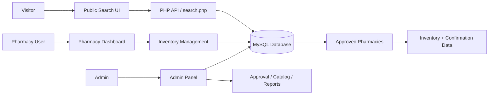
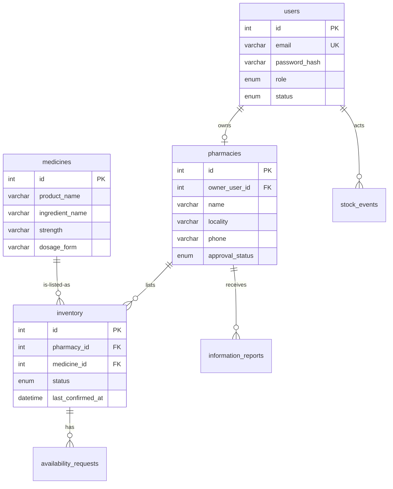

# MedRadar

<div align="center">
  
</div>

<p align="center">
  
  
  
  
  
</p>

MedRadar is a demo medicine availability and pharmacy verification platform designed to help visitors find the exact medicine product at approved pharmacies, check how recently a stock confirmation was made, and request fresh updates when needed.

This repository contains the complete project implementation under the `medicine-finder/` folder, including the frontend, backend, API layer, database schema, tests, and supporting documentation.

## Why this project?

Many patients and visitors need to confirm whether a specific medicine is available at a nearby pharmacy before traveling. MedRadar solves this by creating a clear, role-based workflow:

- Visitors can search for a medicine by name, dosage, and locality
- Pharmacies can confirm availability and freshness of stock
- Admins can approve pharmacies and manage catalog data
- Requests and reports keep the system transparent and auditable

## Features at a glance

| Area | Capability |
|---|---|
| Public Search | Search medicines by product name, strength, and locality or PIN code |
| Pharmacy Verification | Show only admin-approved pharmacies with stock confirmation timestamps |
| Freshness Tracking | Highlight whether a medicine was recently confirmed or may be stale |
| Request Workflow | Visitors can request confirmation and track status privately |
| Admin Controls | Approve, reject, suspend, or reactivate pharmacies and catalogue entries |
| Role-based Access | Separate access for visitors, pharmacies, and administrators |
| Security | CSRF protection, prepared statements, session checks, and authorization controls |
| Demo Data | Built for academic/prototype use with fictional sample data |

## Architecture overview



## Tech stack

| Layer | Technologies |
|---|---|
| Frontend | HTML5, CSS3, JavaScript, responsive UI |
| Backend | PHP 8, PDO, session handling, role-based authorization |
| Database | MySQL / MariaDB |
| API | REST-style JSON endpoints |
| Security | CSRF tokens, input validation, prepared statements |
| Deployment | XAMPP / Apache + MySQL local environment |

## Repository structure

```text
MedRadar_01/
├── LICENSE
├── README.md
├── medicine-finder/
│   ├── .env.example
│   ├── .gitignore
│   ├── .htaccess
│   ├── API.md
│   ├── TESTS.md
│   ├── README.md
│   ├── about.php
│   ├── admin/
│   ├── api/
│   ├── assets/
│   ├── config.php
│   ├── cron/
│   ├── css/
│   ├── dashboard.php
│   ├── database/
│   ├── docs/
│   ├── inc/
│   ├── index.php
│   ├── inventory.php
│   ├── js/
│   ├── login.php
│   ├── logout.php
│   ├── pharmacy.php
│   ├── profile.php
│   ├── report.php
│   ├── requests.php
│   ├── tests/
│   ├── track.php
│   └── ...
└── ...
```

## Quick start

### Prerequisites

- PHP 8.1+
- Apache or XAMPP
- MySQL / MariaDB
- Git

### 1) Clone the repository

```bash
git clone https://github.com/Vikranth-patel/MedRadar_01.git
cd MedRadar_01
```

### 2) Set up the app

Navigate to the project folder:

```bash
cd medicine-finder
```

Copy the example environment file:

```bash
cp .env.example .env
```

Update the database credentials in `.env` if needed.

### 3) Import the database

Open phpMyAdmin and import:

- `database/schema.sql`
- `database/seed.sql`

or via terminal:

```bash
mysql -u root -p < database/schema.sql
mysql -u root -p < database/seed.sql
```

### 4) Run the application

With XAMPP:

- Start Apache and MySQL
- Open: `http://localhost/medicine-finder/`

Or run locally:

```bash
php -S 127.0.0.1:8080
```

Then visit:

```text
http://127.0.0.1:8080
```

## Demo accounts

The project includes demo users for testing the workflow.

| Role | Email | Password | Notes |
|---|---|---|---|
| Administrator | `admin@medradar.test` | `password123` | Manages pharmacies, catalog, and reports |
| Approved Pharmacy | `sanjivani@example.com` | `password123` | Visible in public searches |
| Pending Pharmacy | `pending@example.com` | `password123` | Not visible until approved |
| Suspended Pharmacy | `suspended@example.com` | `password123` | Blocked from signing in |

> Change these test credentials before using the project in a real environment.

## User roles

| Role | Permissions |
|---|---|
| Visitor | Search, view pharmacy details, request confirmation, track requests, report issues |
| Pharmacy | Manage own inventory, confirm stock freshness, respond to requests |
| Administrator | Approve/reject pharmacies, maintain catalogue, review reports and activity |

## Core workflow

1. A pharmacy registers and waits for admin approval.
2. Admin approves the pharmacy and its listing becomes public.
3. The pharmacy adds and confirms medicine inventory.
4. Visitors search for medicines and compare availability by pharmacy.
5. Requests and reports help keep the information fresh and reliable.

## Database model



## Important documentation

This repository contains dedicated documentation for the project:

- [Project Overview](./medicine-finder/README.md)
- [API Reference](./medicine-finder/API.md)
- [Test Results](./medicine-finder/TESTS.md)

## Security and limitations

This is a demonstration application and not a medical or regulatory system.

- All data is fictional demo data
- No real diagnosis or emergency medical advice is provided
- Availability data is pharmacy-reported and not guaranteed
- Access is role-based and limited to demo usage

## License

This project is licensed under the [MIT License](./LICENSE).

## Contributing

Contributions, feature ideas, and bug reports are welcome.

```bash
git checkout -b feature/your-feature
git commit -m "Add your feature"
git push origin feature/your-feature
```

## Contact

For questions or collaboration opportunities, use the repository discussion or contact the project maintainer through GitHub.

---

<p align="center">
  <strong>Built with ❤️ for medicine accessibility and public health awareness.</strong>
</p>
